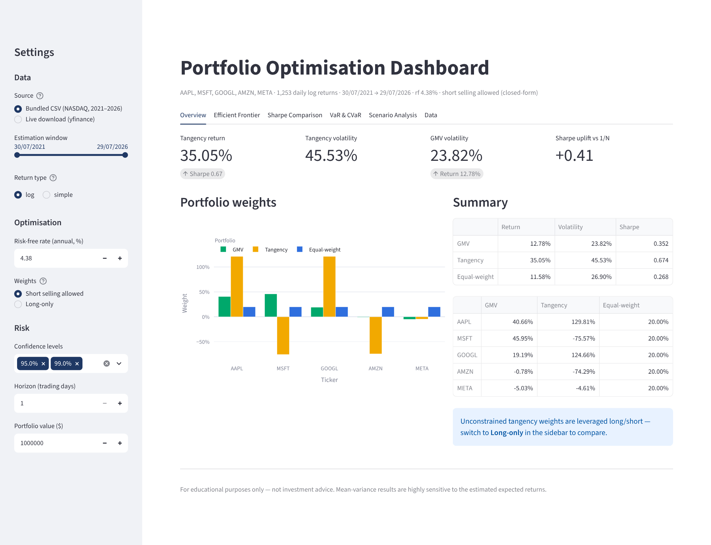
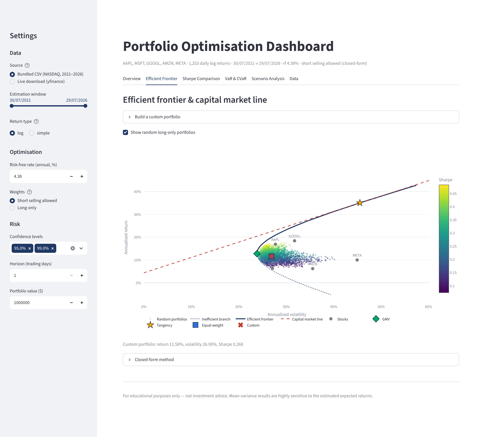
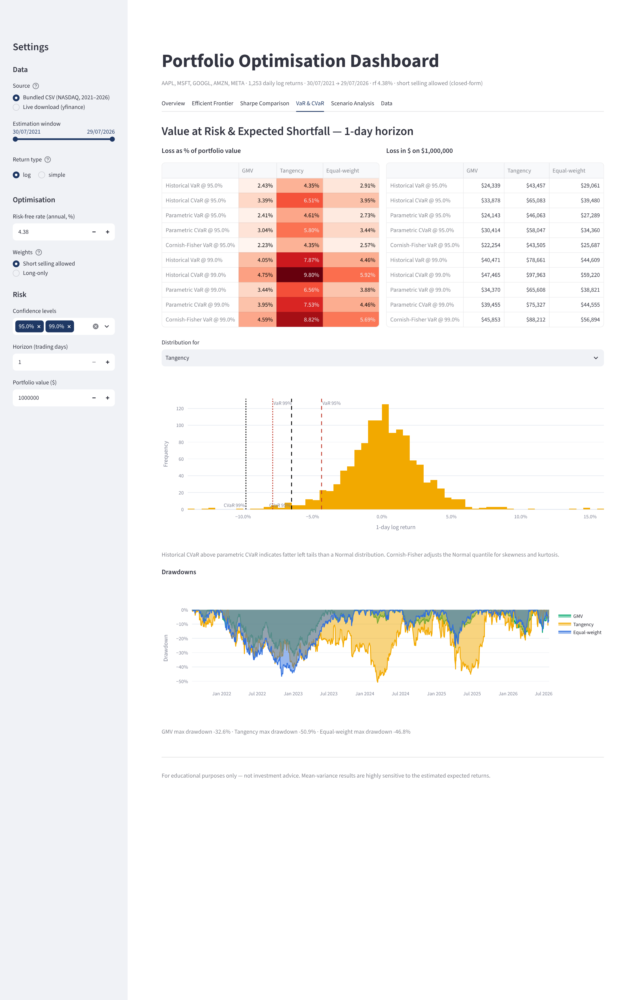
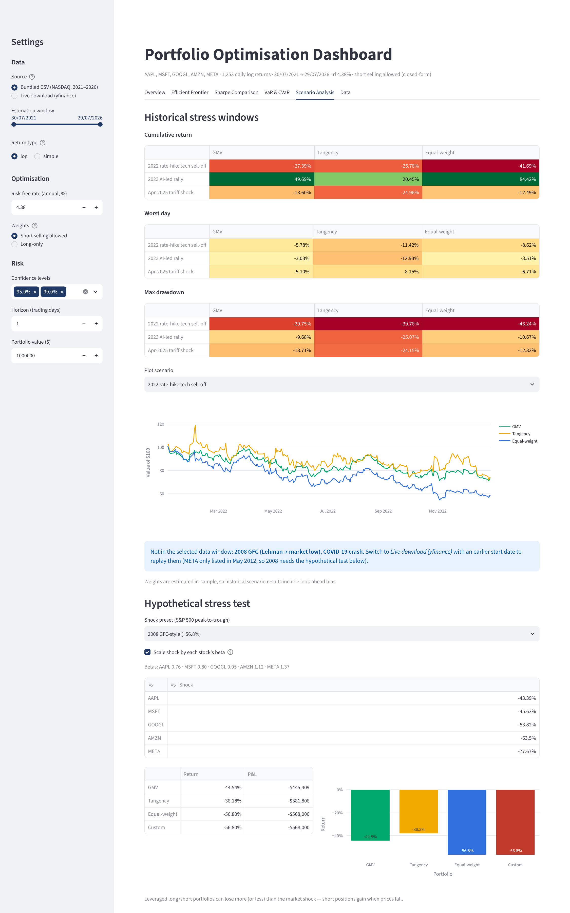
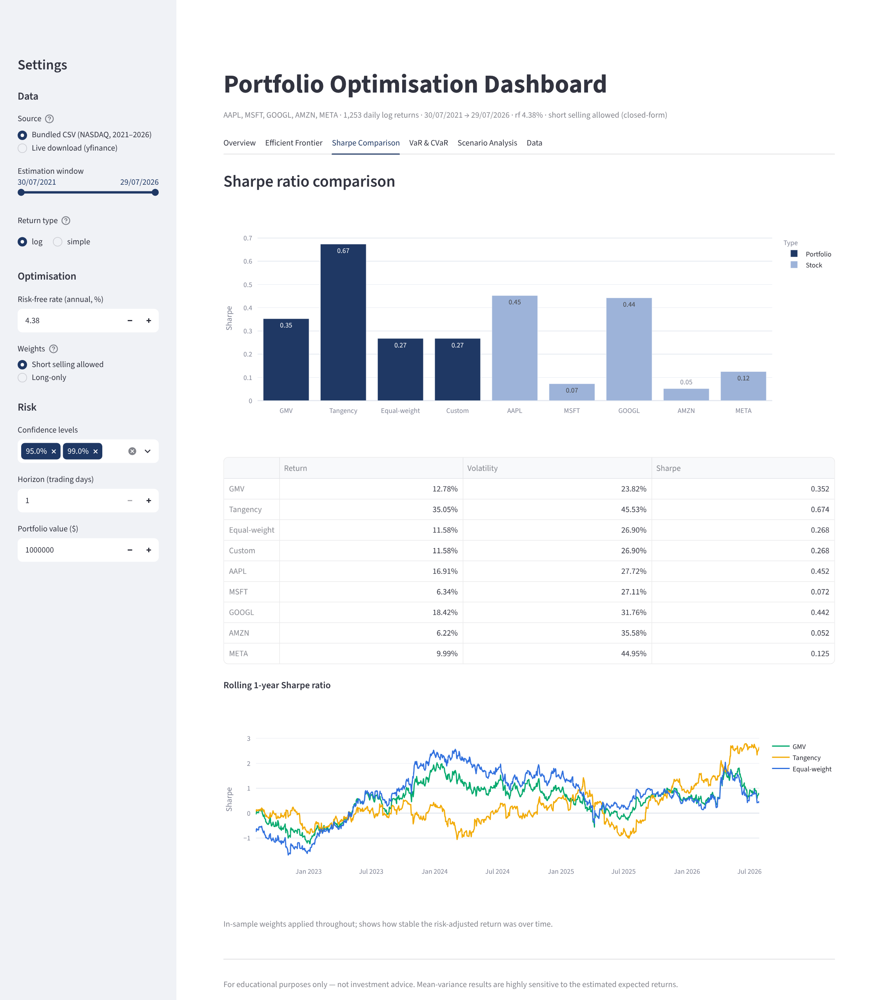
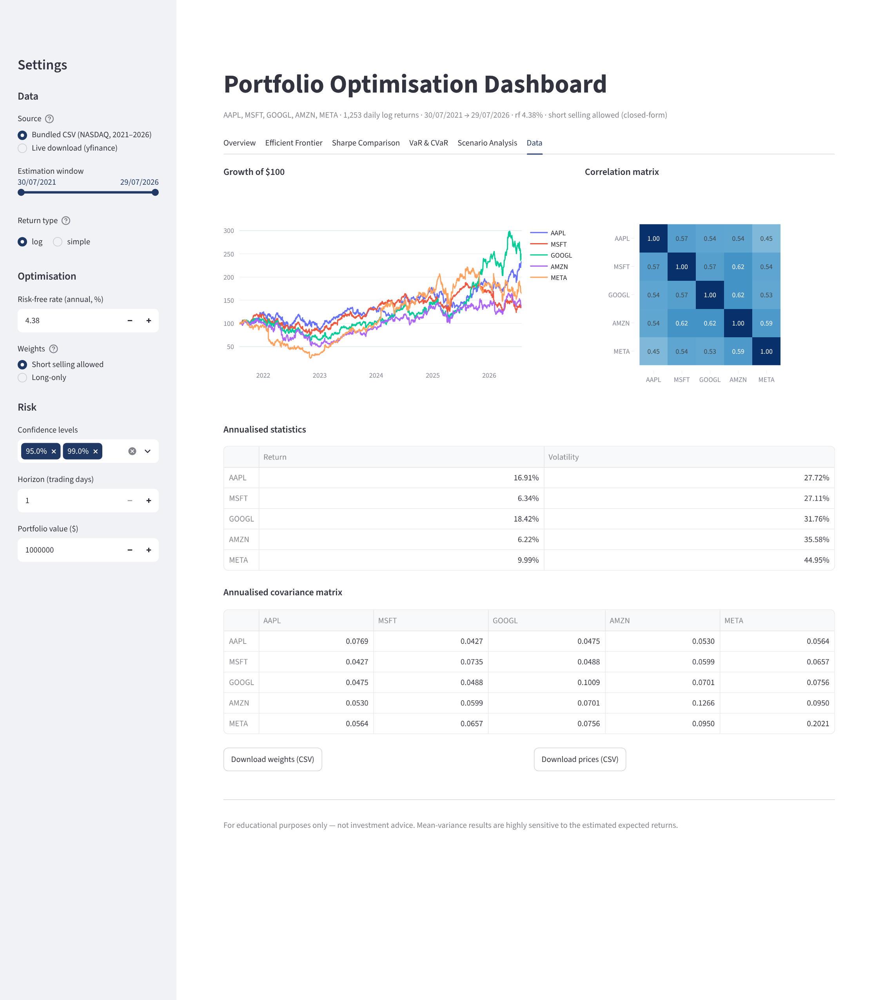

# Portfolio Optimisation Dashboard

An interactive mean-variance portfolio optimisation dashboard for five large-cap US tech stocks
(**AAPL, MSFT, GOOGL, AMZN, META**), built in Python and deployed with Streamlit. It is the
Python companion to an Excel model of the same project, and reproduces its results exactly.

**Features**

- **Efficient frontier**: an analytical frontier when short selling is allowed, or a numerical one (SciPy SLSQP) when weights are long-only or capped. It also shows the capital market line, a cloud of random portfolios, and a custom portfolio you build yourself.
- **GMV and tangency portfolios** (minimum variance and maximum Sharpe), compared against an equal-weight (1/N) benchmark.
- **Sharpe ratio comparison** across portfolios and individual stocks, plus a rolling 1-year Sharpe ratio.
- **VaR and CVaR**: historical, parametric (Normal) and Cornish-Fisher methods, at any confidence level and a 1–20 day horizon, shown as % losses and $ losses. Includes a return histogram and drawdown chart.
- **Scenario analysis**: historical stress windows (2008 GFC, COVID-19, the 2022 sell-off, the 2023 rally, the April 2025 tariff shock) and a hypothetical stress test that scales each stock's shock by its beta.
- **Data**: bundled NASDAQ closing prices (30/07/2021 – 29/07/2026), or a live download of any tickers and dates from Yahoo Finance.

## Screenshots

| Overview | Efficient frontier |
|---|---|
|  |  |

| VaR & CVaR | Scenario analysis |
|---|---|
|  |  |

| Sharpe comparison | Data |
|---|---|
|  |  |

## Project structure

```
portfolio-optimisation-dashboard/
├── data_pipeline.py      # load prices (CSV / yfinance), returns, annualised μ, Σ, σ, ρ
├── optimisation.py       # GMV, tangency, efficient frontier, CML (closed-form + SciPy)
├── risk.py               # VaR / CVaR, drawdowns, betas, historical & hypothetical scenarios
├── dashboard.py          # Streamlit app
├── data/prices.csv       # bundled daily closing prices (same as the Excel Data sheet)
├── tests/test_against_excel.py   # checks Python results against the Excel model
├── screenshots/
├── .streamlit/config.toml
└── requirements.txt
```

## Instructions

### Run locally
```bash
git clone https://github.com/<your-username>/portfolio-optimisation-dashboard.git
cd portfolio-optimisation-dashboard
python -m venv .venv && source .venv/bin/activate      # Windows: .venv\Scripts\activate
pip install -r requirements.txt
streamlit run dashboard.py
```
The app opens at http://localhost:8501.

### Run the tests
```bash
pytest -q
```

### Run a module on its own
```bash
python data_pipeline.py   # prints annualised stats
python optimisation.py    # prints GMV / tangency weights and stats
```

### Deploy to Streamlit Community Cloud
1. Push this folder to a public GitHub repository.
2. Go to [share.streamlit.io](https://share.streamlit.io), click **Create app**, and choose the repository.
3. Set **Main file path** to `dashboard.py` and click **Deploy**.

## Methodology

| Step | Formula / choice |
|---|---|
| Returns | Daily log returns `ln(Pt / Pt−1)` (simple returns available as an option) |
| Annualisation | μ = mean × 252, Σ = daily covariance × 252, σ = √diag(Σ) (population covariance, matching Excel `STDEV.P`) |
| GMV | `w = Σ⁻¹1 / 1ᵀΣ⁻¹1` |
| Tangency | `w = Σ⁻¹(μ − rf·1) / 1ᵀΣ⁻¹(μ − rf·1)` |
| Frontier | `σ²(μp) = (Aμp² − 2Bμp + C) / D`, where A = 1ᵀΣ⁻¹1, B = 1ᵀΣ⁻¹μ, C = μᵀΣ⁻¹μ, D = AC − B² |
| Capital market line | `μp = rf + SR_tan × σp` |
| Constrained case | SciPy SLSQP: minimise variance or maximise Sharpe, with Σw = 1 and 0 ≤ w ≤ cap |
| Historical VaR / CVaR | Empirical (1−α) percentile of portfolio returns; CVaR is the mean of the returns beyond it |
| Parametric VaR / CVaR | `VaR = −(μ + zσ)`, `CVaR = −(μ − σφ(z)/(1−α))`, where z = Φ⁻¹(1−α) |
| Cornish-Fisher VaR | Normal quantile adjusted for skewness and excess kurtosis |
| Multi-day horizon | Overlapping h-day returns (historical); μ·h and σ·√h (parametric) |
| Hypothetical stress | Stock shock = βᵢ × market shock, with β measured against an equal-weight basket of the stocks |

**Key lesson from the Excel model:** μ, Σ and rf must all be in the same units. Subtracting an
*annual* risk-free rate from *daily* mean returns makes every excess return roughly equal to −rf.
The tangency formula then collapses to the GMV formula and lands on the inefficient branch, just
below the GMV. `tests/test_against_excel.py` reproduces this bug in
`test_unit_mismatch_bug_reproduced`.

## Results (bundled data, rf = 4.38%, short selling allowed)

| Portfolio | Return | Volatility | Sharpe |
|---|---|---|---|
| GMV | 12.78% | 23.82% | 0.352 |
| Tangency | 35.05% | 45.53% | 0.674 |
| Equal-weight | 11.58% | 26.90% | 0.268 |

## Limitations

- **In-sample estimates.** The weights are fitted on the same data used to evaluate them, so scenario and VaR results contain look-ahead bias.
- **Sensitivity to expected returns.** Mean-variance weights react strongly to small changes in μ. With short selling allowed, the tangency portfolio is a leveraged long/short position.
- **Data window.** The bundled data starts in July 2021, so the 2008 and COVID windows need a yfinance download from an earlier start date. META only listed in May 2012, so 2008 can only be modelled with the hypothetical stress test.
- **Small VaR differences from Excel.** The Python version aggregates portfolio returns in simple-return space, then converts back to log returns. The Excel model weights log returns directly, so VaR figures differ slightly (by about 0.1 percentage points).

*For educational purposes only, not investment advice.*
